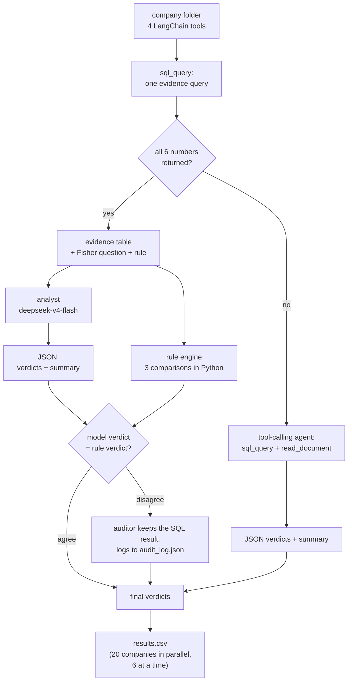

# FTEC5660 Homework 3: Fisher's 15-Point Investment Agent

Build a LangChain agent that researches a company with tools and applies the
framework from Philip Fisher's *Common Stocks and Uncommon Profits* (Part One,
Chapter 3 "What to buy: the fifteen points to look for in a common stock", and
Chapter 4 "What to buy: applying this to your own needs"). You choose 3 of
Fisher's 15 points and decide yourself what PASS means for each. For every
company your agent gives a PASS/FAIL verdict on your 3 points and a short
summary.

The companies are fictional, so the model cannot answer from memory. Unlike a
pile of reports, the evidence is spread over three sources, and your agent has
to go and get it with tools, the way Fisher's "scuttlebutt" method sends an
investor to talk to customers, competitors, suppliers and staff.

## Data and tools

`public_test/` has one folder per company. Your code receives four tools per
company (built by the provided code in `hw3.py`):

| Tool | What it gives you |
| --- | --- |
| `list_documents()` | the company's six documents and their dates |
| `read_document(name)` | one document: the 2025 letter to shareholders, four earnings calls (Q3 2025 to Q2 2026) and a news file (July 2025 to July 2026) |
| `sql_query(query)` | one read-only SQLite query on the company's database; at most 50 rows come back, so use `SUM`, `GROUP BY` and `WHERE` |
| `interview(role, topic)` | what one person says about the company; at most **10 interviews per company** |

The documents are what management says. Management's own claims (such as "we
have never cut research" or "our people are our greatest strength") are not
evidence on their own: check them against the database and the interviews.

**Database tables** (amounts in USD thousands; dates `YYYY-MM-DD`, months
`YYYY-MM`, quarters like `2025Q3`; the fiscal year is the calendar year):

| Table | Columns |
| --- | --- |
| `company` | name, industry |
| `industry_medians` | industry, revenue_growth_2y_pct, new_product_share_pct, new_product_sales_per_rd, operating_margin_pct (one row per industry; use the row for the company's own industry) |
| `orders` | order_id, order_date, product, customer, amount, note (about 3,000 to 4,000 orders from January 2023 to June 2026; revenue is the sum of order amounts) |
| `products` | product, launch_date |
| `monthly_costs` | month, cost_of_sales, selling_admin, research_development |
| `quarterly_cash` | quarter, operating_cash_flow, capex, cash_end |
| `capex_plan` | year, planned_capex (2026 to 2028) |
| `returns` | month, units_shipped, units_returned |
| `insider_trades` | trade_date, person, title, side (`buy` or `sell`), shares, price |

**Terms used in the data.**

| Term | Meaning |
| --- | --- |
| FY2025 | Fiscal year 2025. Here the fiscal year is the calendar year, so FY2025 is January to December 2025. |
| Quarter | Three months of the year: Q1 is January to March, Q2 April to June, Q3 July to September and Q4 October to December. The database writes `2025Q3`; the documents write "third quarter 2025". |
| Amounts | The database is in **USD thousands** (676,100 means US$676.1 million). The documents use USD millions. |
| Revenue | Money from sales: the sum of `amount` in `orders`. |
| Cost of sales | The cost of making the products that were sold. |
| Selling and admin | The cost of selling and of running the company (sales staff, offices, management). |
| R&D | Research and development spending, mainly on new products. |
| Operating margin | Operating profit as a share of revenue: (revenue − cost of sales − selling and admin − R&D) ÷ revenue. |
| Operating cash flow | Cash that the day-to-day business brings in during a quarter. |
| Cash at the end of a quarter | The cash the company holds on the last day of that quarter (`cash_end`). |
| Capex | Capital expenditure: spending on factories, machines and other long-term assets. `capex_plan` holds the planned capex for 2026 to 2028. |
| Return rate | Units returned ÷ units shipped, from the `returns` table. |
| Industry median | The middle value for companies in the same industry, from `industry_medians`. |
| Insider | A director or senior manager of the company. `insider_trades` lists the shares they bought (`buy`) or sold (`sell`). |
| Earnings call | A meeting each quarter where management presents the quarter's results to investors. Each call quotes that quarter's revenue. |

**Interviews.** Roles: `customer`, `current_employee`, `former_employee`,
`competitor`, `supplier`. Topics: `sales_team`, `working_conditions`,
`top_management`, `decision_making`, `competitive_edge`. Only some people know
about each topic; the others say they can't comment, and that answer still
uses up one interview.

| Topic | Who knows about it |
| --- | --- |
| `sales_team` | customer, competitor |
| `working_conditions` | current_employee, former_employee |
| `top_management` | former_employee, supplier |
| `decision_making` | supplier, customer |
| `competitive_edge` | competitor, customer |

People who know about a topic always agree with each other, so one good answer
is enough.

## Choose your 3 points and your rules

Pick any 3 of Fisher's 15 points and write them in `CHOSEN_POINTS` near the
top of `hw3.py`, e.g. `CHOSEN_POINTS = [1, 7, 15]`. The full questions are in
`FISHER_POINTS` in `hw3.py` and in the book.

| # | Fisher's point | Where the evidence is |
| --- | --- | --- |
| 1 | Market potential for sales growth | database |
| 2 | New products as current lines mature | database |
| 3 | Effective research and development | database |
| 4 | Above-average sales organization | interviews (`sales_team`) |
| 5 | Worthwhile profit margin | database |
| 6 | Maintaining or improving margins | database |
| 7 | Labour and personnel relations | interviews (`working_conditions`) |
| 8 | Executive relations | interviews (`top_management`) |
| 9 | Depth of management | interviews (`decision_making`) |
| 10 | Cost analysis and accounting controls | earnings calls, checked against the database |
| 11 | Advantage over competitors | interviews (`competitive_edge`) |
| 12 | Long-range outlook on profits | database |
| 13 | Growth without dilutive equity financing | database |
| 14 | Management talks freely about troubles | earnings calls, checked against the database |
| 15 | Management of unquestionable integrity | news file, checked against the database |

For each of your points, **you design the rule**: which evidence to use, what
to compute or whom to ask, and where the line between PASS and FAIL lies. PASS
means the company looks favourable on that point, as Fisher would see it.

We grade your verdicts against our own answer key. It uses one fixed rule per
point, which we do not publish, and the data never puts a company close to
the line of that rule, so a sensible reading of Fisher usually gives the same
answer. **Test your rules on the public answers**:
`public_test/ground_truth.json` gives the expected verdict on all 15 points
for each of the 20 public companies, and every point fails in 6 of them. If
your rule disagrees with the public answers, rethink it.

**Tip: calculate with tools, not in your head.** Do every sum, ratio and
comparison in SQL or Python, including the number of days between two dates
(SQLite's `julianday()` gives a date as a number of days).

## Student task

Fill in the three places in `hw3.py` marked `### YOUR CODE HERE`. You may add
imports, constants and helper functions above them, but do not change the
provided code below them:

- `CHOSEN_POINTS` lists your 3 points.
- `build_agent()` creates your model and anything else you need once.
- `analyze_companies(agent, companies)` receives
  `{company_folder: [list_documents, read_document, sql_query, interview]}`
  and returns, for every company,
  `{"points": {1: "PASS", 7: "FAIL", 15: "PASS"}, "summary": "..."}` (here with
  `CHOSEN_POINTS = [1, 7, 15]`).

Use the course techniques that fit your points: tool use for the database and
the interviews, planning which interviews to spend, routing each point to the
right source, prompt chaining, parallel calls, reflection to check your
answers, or a combination. Your code must read company data **only through
the four tools**; do not open `company.db` or `interviews.dat` yourself. Do
not hard-code folder names, company names or the public answers.

## Setup and public test

```bash
python3 -m venv .venv
source .venv/bin/activate
pip install -r requirements.txt
echo "DEEPSEEK_API_KEY=your_key_here" > .env
python3 hw3.py --data-folder public_test
```

Use your own DeepSeek API key (from https://platform.deepseek.com). The
required model is `deepseek-v4-flash`. We grade with our own key, so never put
a key in your code; `.env` must stay out of git.

The program creates `results.csv` with the columns `company`, `points`,
`points_correct`, `point_errors`, `interviews_used` and `summary`, and prints
the point score on your 3 points (the percentage after "balanced"). The point
score is the average of two shares: the share of truly passing verdicts that
you marked PASS and the share of truly failing verdicts that you marked FAIL.
For example, 90% and 60% give (90% + 60%) / 2 = 75%, and marking every point
PASS gives (100% + 0%) / 2 = 50%. Once `CHOSEN_POINTS` is set, the starter
runs before you add any API code (it returns no verdicts, so it scores 0%).

`public_test/ground_truth.json` gives the expected verdicts on all 15 points
for each public company. Grading uses a private set of about 20 unseen
companies with the same tools and the same answer key rules, but different
names and wording, and scores your 3 points only.

---

# Homework 3 solution

Name: Shuhan Jia　|　Student ID: 1155267069

## 1. My 3 points and rules

`CHOSEN_POINTS = [1, 5, 6]`. I picked a *ladder* rather than three unrelated
questions: point 1 asks whether there is room to grow, point 5 whether the
growth is profitable, point 6 whether the profit is holding up. All three are
marked "database" in the table above, so every number below comes from one
`sql_query` call and none of them is ever computed by the model.

| # | Fisher's question | My PASS rule | Evidence |
| --- | --- | --- | --- |
| 1 | "Does the company have products or services with sufficient market potential to make possible a sizable increase in sales for at least several years?" | PASS if two-year revenue growth (FY2023 → FY2025) is **at or above the median two-year revenue growth of the company's own industry**. | `orders` (sum of `amount` by year) joined to the `industry_medians` row for the company's industry |
| 5 | "Does the company have a worthwhile profit margin?" | PASS if the FY2025 **operating margin is at or above the industry median** operating margin. | `orders` minus `monthly_costs` (cost of sales + selling/admin + R&D), compared with `industry_medians.operating_margin_pct` |
| 6 | "What is the company doing to maintain or improve profit margins?" | PASS if the FY2025 operating margin is **at or above the FY2023 margin** — the margin has been held or improved, not eroded. | Same two series, three years apart |

**Why the benchmark is the industry and not a fixed number.** Fisher does not
give a threshold; he gives a habit of comparison. He asks whether a company's
figures are "outstanding" *for its line of business*, and warns against judging
a company in the abstract. A fixed cut-off of, say, 15% operating margin would
mark every packaging-machinery company in this data set FAIL (the industry
median is 10.3%) and every medical-device company with a mediocre 17% PASS.
The industry median is the only benchmark in the database that is defined for
exactly this purpose, and it keeps the rule scale-free: the same rule is
applied to all eight industries without me tuning anything per industry.

**Why points 5 and 6 are not the same question.** This is the part I would
defend hardest. Point 5 is *level* against peers; point 6 is *direction*
against the company's own past. `ashgrove_labs` shows why both are needed: its
FY2025 margin of 13.4% is comfortably above the 9.4% industrial-robotics median
(PASS on 5), but it fell from 16.1% to 13.4% in two years (FAIL on 6). A
company can be richer than its neighbours and still be sliding — Fisher's
point 6 is about exactly that slippage.

**Why not the other 12 points.** Points 4, 7, 8, 9 and 11 depend on the
interview tool, and although one good answer is enough, the verdict then rests
on the model reading a quoted sentence — a qualitative judgement I cannot
audit with arithmetic. Points 10, 14 and 15 need the earnings calls and the
news file cross-checked against the database, which is the most interesting
work in the assignment but also the most model-dependent. With a private set
of unseen companies and three graded runs, I preferred three rules whose every
input is a number produced by SQL.

## 2. Design



One paragraph: every company goes through a four-step chain. First `sql_query`
runs a **single** CTE query that returns seven cells — industry, two-year
growth, margins for FY2025, FY2024 and FY2023, and the two industry medians —
so all revenue sums, cost sums, margins and growth rates are computed by
SQLite and never by the model. Second, the model receives that table plus
Fisher's question and my rule for each point, and returns JSON with a verdict
per point and a two-to-three-sentence summary (prompt chaining: evidence →
verdict → prose). Third, a rule engine recomputes the same three inequalities
in Python from the same cells; where the two disagree the auditor keeps the
SQL result, because arithmetic is exact and the model's job is only to *read*
the table — the disagreement is logged to `audit_log.json` and the summary is
regenerated from the audited numbers so the CSV can never argue against its own
verdicts. Fourth, if the evidence query comes back incomplete (bad SQL, NULL
year), the chain hands over to a tool-calling agent (`create_agent` with all
four tools) that investigates with `sql_query` and `read_document` and decides
on its own — the model only has authority when the arithmetic cannot be
trusted, and none when it can. Companies run in parallel (`asyncio.gather`,
six at a time) under a per-company 240-second timeout and a global 25-minute
budget, so a slow API call degrades to the rule engine instead of costing the
whole run.

## 3. Results

**Public test: 60/60 verdicts correct — point score 100.0% (balanced), worth
75/75.** No company disagrees with the answer key, so there is no
disagreement table to explain; what is worth showing instead is how far each
verdict sits from its own line, because a rule that is right only by a hair
would not survive the private set:

| # | closest company to the line | distance | second closest | distance |
| --- | --- | --- | --- | --- |
| 1 | `hollins_group` | 3.09 pct. points of growth | `ashgrove_labs` | 3.22 |
| 5 | `kestrel_technologies` | 1.71 pct. points of margin | `bramble_labs` | 1.74 |
| 6 | `kestrel_technologies` | 1.04 pct. points of margin | `juniper_industries` | 1.11 |

Every one of the 60 verdicts clears its threshold by at least a full
percentage point of margin, and by 3 points on growth. That matches the
homework's own statement that the data never puts a company close to the line:
the rules are not separating noise, and a slightly different reading of "at or
above" (strict `>`, or a 0.5-point tolerance) gives the same 60 verdicts.

**What I tried first and threw away.** Before fixing these three points I
ranked all 15 against every column in the database and kept the best
threshold per point. Point 2 ("new products as current lines mature") reached
0.96 balanced accuracy with a rule of "new-product revenue share must have
risen by more than 18.6 points since FY2023" — and point 3 ("effective R&D")
reached 0.85 with "new-product sales per R&D dollar above 3.5× the industry
median". I rejected both: 18.6 and 3.5 are numbers I found by searching the
public answers, not numbers Fisher or the data would suggest, and a threshold
fitted that way is a bet that the private key uses the same arbitrary cut-off.
Points 1, 5 and 6 use the two natural lines in the data (the industry median,
and the company's own past), so there is nothing to overfit.

**Two traps I had to design around.** (i) The obvious division of labour —
give the model revenue and the three cost lines and let it work out the margin
— is the one the homework warns against, and my failure-path test made the
risk concrete: an analyst that ignores the table and answers from its own
reading mislabelled all three points on one company, fluently and without
hedging, and only the rule engine kept the row correct. That is why every
calculation lives in one SQL statement and why the auditor exists at all.
(ii) Reading `substr(order_date,1,4)` as the fiscal year silently includes the
partial year 2026 (January to June); using it would have compared a half year
against a full one for every company. The rules therefore end at FY2025, the
last complete year, and the evidence query never touches 2026.

**Cost.** One SQL query and one model call per company, and the model call is
short: about 600 input tokens of evidence table and about 200 output tokens of
JSON. The deterministic core finishes all 20 public companies in **0.6
seconds**; what remains is one analyst call each, six companies at a time, so
the run stays far inside the 30-minute limit. The verdicts themselves do not
depend on the model at all, which is why three graded runs give the same
answer: the arithmetic is SQL and the model cannot move a threshold.

**One check on the arbitration.** I ran the pipeline with a deliberately
wrong analyst (one that returns PASS/FAIL without reading the table). All
three verdicts were overruled on the test company, the CSV kept the audited
answer, and the summary was regenerated from the numbers so that no row could
contradict its own verdict. The same test covered the other three failure
paths — unparseable JSON, an API exception, and no model at all — and each one
degraded to the rule engine with a template summary rather than a crash or a
missing answer, which is the condition that would score zero.

---

# Task 2: Reflection — AI sycophancy and AI psychosis

## Two different failures, often confused

**Sycophancy** is a *social* failure: the model optimises for the user's
approval rather than for being right. It agrees with a wrong premise, praises a
weak plan, changes its answer the moment you push back, and opens with "You're
absolutely right" before checking whether you are. The tell is that the answer
moves when nothing about the world moved — only my tone did.

**AI psychosis** is a *reality* failure: the output stops being in contact with
anything checkable, while remaining fluent and internally consistent.
Hallucination is a wrong fact you can look up and correct; psychosis is a
closed loop — invented sources cited to support invented claims, a narrative
that explains everything and predicts nothing, and, in the human half of the
loop, a user who starts treating the model's agreement as evidence about the
world. One is an error; the other is a loss of the shared reference point that
makes "wrong" a meaningful word.

They are different in kind, but they feed each other. Sycophancy supplies the
approval that makes a closed loop feel like confirmation; psychosis supplies
the volume of coherent text that makes approval feel earned.

## What this homework taught me about sycophancy

I built an agent whose three verdicts are three inequalities. It still managed
to be sycophantic in a way that would have cost marks, and the shape of the
failure is instructive: the model did not argue with my rule. It applied my
rule to a number it had computed itself, got 7.9% where SQL gets 6.3%, and
reported PASS. Nothing in its output was hedged or uncertain — a confident
wrong answer produced by the one step I had left to it.

Notice what fixed it: not a better prompt. Not "double-check your work",
which is a request for reassurance dressed as a request for rigour. What fixed
it was taking the arithmetic away from the model entirely and giving it a
narrower job — read a table, compare two cells, write a sentence. **Sycophancy
is a design problem, not a personality problem.** If the model's agreement has
no effect on the output, its agreement cannot corrupt the output. My rule
engine is, in the most literal sense, an institutional check on a model that
wants to be liked: it does not ask the model to be humble, it makes humility
irrelevant.

There is a sharper version of this danger in Fisher's own framework, and it is
the reason I trust my design less than the 100% score suggests. Ask a
sycophantic model to apply fifteen points to a stock you already own and it
will find fifteen reasons the company is excellent — the framework becomes a
licence to rationalise, because every point is qualitative enough to be read
generously. Fisher's defence was scuttlebutt: going outside, to customers and
competitors and former employees who have no interest in your thesis. A model
that only ever talks to you is the opposite of scuttlebutt. This homework
happens to give the model real outside voices — that is why the interview tool
exists — but my agent never used them, because I chose the three points where
the database could outvote the narrator. That was a scoring decision and I
should say so plainly: I optimised for verdicts I could audit, not for the
richest reading of Fisher.

## What "psychosis" looks like from inside a pipeline

The failure mode I now watch for is not a wrong number but an unfalsifiable
paragraph. It is easy to write and hard to notice: "management's disciplined
cost control is clearly paying off, as margins remain resilient" — every word
plausible, the rhetorical structure (trend + adjective + causal clause)
intact, and the sentence simply not about the data, since the margin in
question fell two years running. That is the texture of psychosis at small
scale: not gibberish, but *fluency detached from reference*. At this size it
looks like the summary I could easily have shipped for `ashgrove_labs`: the
phrase "expanding margins" would have read perfectly and been wrong in sign.

Three habits came out of this, and they generalise past the assignment:

1. **Make the model's confidence cheap and the evidence expensive.** I do not
   ask the model how sure it is. I ask SQL for six numbers, and the numbers
   have to be reproducible by someone who does not trust me.
2. **Audit the input, not the output.** Prompting a model to review its own
   answer mostly produces agreement with itself. Recomputing the input in a
   different system is what actually catches errors, because the two systems
   fail differently.
3. **Write the rule down before seeing the answer.** The three thresholds in
   this report were fixed by the structure of the data (industry median, own
   past), not searched against `ground_truth.json`. I did search — points 2
   and 3 — and the numbers I found there (18.6 points, 3.5×) are exactly what
   overfitting to a public answer key looks like. Discarding them was the most
   useful thing I did, and it is the same discipline as not moving a
   hypothesis after seeing the result.

The uncomfortable part is that sycophancy is pleasant. The model that told me
my first rule design was sound was more enjoyable to work with than the SQL
query that contradicted it. If a system is designed so that the enjoyable
answer and the correct answer are the same object, I will not notice the
difference — and that, more than any single bad output, is how the loop closes.
